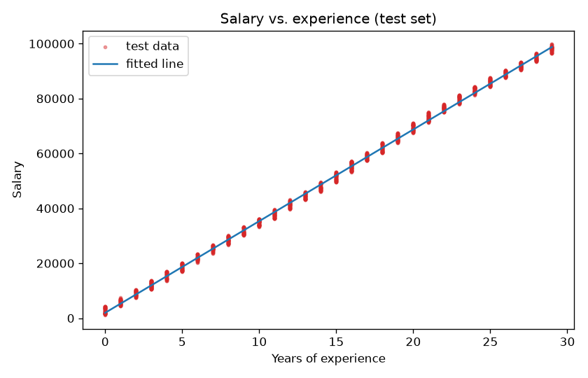

# Salary Prediction with Linear Regression

A minimal, fully reproducible simple-linear-regression project: predict salary from years of
experience with scikit-learn, evaluate it properly, and plot the fit. Good as a first ML project or
as a reference for the standard train/test/evaluate workflow.



## What success looks like

Run the quickstart to print held-out metrics and regenerate the plots in `docs/`; run the tests separately to check the workflow. This is a **synthetic-data teaching example**, not a salary valuation service. The CSV does not establish a currency, geography, occupation or fair compensation policy; do not use the fitted line for hiring or pay decisions.

## Results

Trained on 2/3 of the data, evaluated on the held-out 1/3 (`random_state=0`):

| | value |
|---|---|
| fitted model | `salary ≈ 3 338.84 × years + 1 958.27` |
| R² (test) | **0.9985** |
| MAE (test) | ≈ 936 |

Interpretation: each additional year of experience adds about 3 339 dataset salary units in this dataset,
with a starting salary of roughly 1 958. The relationship is almost perfectly linear, which tells you
this is a teaching dataset (see below) rather than real-world HR data.

## Dataset

`data/exp_vs_salary.csv` — 5 000 rows, two columns:

| column | range |
|---|---|
| `Years of Experience` | 0 – 29 (integers) |
| `Salary` | 1 036 – 99 980 |

It is a synthetic dataset with a strong linear trend and small noise, which is why R² is so high.
The point of the project is the workflow, not the numbers.

## Quick start

```bash
git clone https://github.com/RANJITHROSAN17/linear-regression-machine-learning.git
cd linear-regression-machine-learning
python -m venv .venv && source .venv/bin/activate     # Windows: .venv\Scripts\activate
python -m pip install -r requirements.txt pytest

python salary_prediction.py          # prints metrics, saves plots to docs/
python salary_prediction.py --show   # also opens the plots
python -m pytest                     # runs the tests
```

Or open `salary_prediction.ipynb` for the step-by-step notebook version.

## What the code does

1. Load the CSV with pandas and split into features `X` (years) and target `y` (salary).
2. `train_test_split` (1/3 test, fixed seed) so the evaluation is honest and reproducible.
3. Fit `sklearn.linear_model.LinearRegression`.
4. Report the coefficient, intercept, R² and MAE on the **test** set.
5. Plot the data and the fitted line for both splits (`docs/training_set.png`, `docs/test_set.png`).

## Project structure

```
salary_prediction.py        script version (CLI, tested)
salary_prediction.ipynb     notebook walkthrough with the same steps
data/exp_vs_salary.csv      dataset
tests/test_model.py         sanity tests (data shape, R² > 0.95, positive slope)
docs/*.png                  generated plots
.github/workflows/          CI: lint + tests + smoke run on Python 3.10–3.12
```

## Possible extensions

- Add polynomial features and compare with the linear fit using cross-validation
- Try a real salary dataset with multiple predictors (education, role, city) → multiple regression
- Residual plots and a check of the regression assumptions
